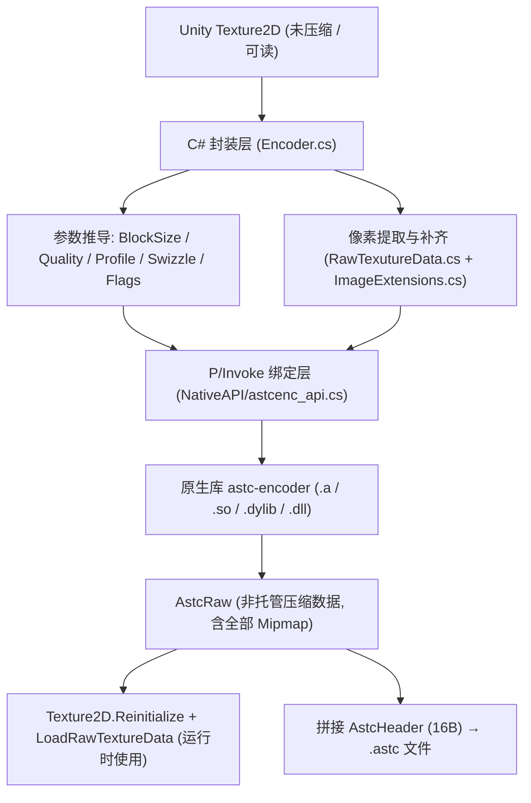

# Runtime ASTC Encoder for Unity

一个面向 Unity 的**运行时 ASTC 纹理压缩库**（Unity Package: `com.aperture.astcenc`），基于 ARM 官方开源的 [astc-encoder](https://github.com/ARM-software/astc-encoder) 交叉编译原生库，通过 C# **P/Invoke** 调用原生编码器，支持在移动端（iOS / Android）及编辑器（Windows / macOS）运行时将未压缩的 `Texture2D` 实时压缩为 ASTC 格式或导出为标准 `.astc` 文件。

---

## 核心特性

- **运行时动态压缩**：无需依赖离线导入管线，可在运行时对动态生成或网络下载的 `Texture2D` 执行 ASTC 压缩，显著降低移动端显存占用。
- **三种使用形态**：
  - 原地压缩并上传 GPU（`Texture2D.Compress`）
  - 获取非托管原始 ASTC 数据缓冲（`Texture2D.CompressTexture` → `AstcRaw`）
  - 导出带标准 16 字节文件头的 `.astc` 字节数组（`Texture2D.EncodeToASTC`）
- **丰富的输入格式支持**：支持 24 种未压缩 `GraphicsFormat`，涵盖 **LDR（8-bit UNorm / sRGB、16-bit UNorm）** 与 **HDR（16-bit / 32-bit Float）**。
- **贴图类型与通道自动适配**：
  - 普通贴图（`TextureType.Default`）：自动处理 `BGRA` 通道重排，对四通道含 Alpha 贴图自动启用 `UseAlphaWeight` 误差加权。
  - 法线贴图（`TextureType.Normal`）：自动启用 `MapNormal` 角度误差优化，并采用 `GGGR` 通道重排（与 Unity 法线压缩布局一致）。
- **完整 Mipmap 链支持**：自动计算每一级 Mipmap 的 ASTC 块数量并逐级压缩，合并为连续的原生内存块供 Unity 直接加载。
- **零 `unsafe` 代码**：程序集配置 `allowUnsafeCode: false`，全部通过 `Marshal` 与 `NativeArray<T>` 安全地完成托管与非托管内存交互，并通过 `IDisposable`（`AstcRaw` / `AstcHeader`）管理原生内存释放。

---

## 支持平台与原生库

预编译的 `astc-encoder` 原生库位于 `Assets/ASTC Encoder/Plugins/` 目录：

| 平台 | 架构 / 环境 | 原生库文件 | P/Invoke `LibraryName` | SIMD 加速 |
| :--- | :--- | :--- | :--- | :--- |
| **iOS** | ARM64（静态库） | `Plugins/iOS/libastcenc-neon-static.a` | `__Internal` | ARM NEON |
| **Android** | `arm64-v8a` | `Plugins/Android/arm64-v8a/libastcenc-neon-shared.so` | `libastcenc-neon-shared` | ARM NEON |
| **Android** | `armeabi-v7a` | `Plugins/Android/armeabi-v7a/libastcenc-none-shared.so` | *(见下方说明)* | None |
| **macOS Editor** | Editor / OSXUniversal | `Plugins/Mac/libastcenc-shared.dylib` | `libastcenc-shared` | — |
| **Windows Editor** | x86_64 | `Plugins/x64/astcenc-sse4.1-shared.dll` | `astcenc-sse4.1-shared.dll` | SSE4.1 |

> **说明**：
> 1. 当前 `astcenc_api.cs` 中 Android 平台的 `LibraryName` 固定为 `"libastcenc-neon-shared"`，对应 `arm64-v8a` 的 `.so`；如需在 `armeabi-v7a` 设备上运行，请统一 `.so` 命名或在 `astcenc_api.cs` 中根据架构区分库名。
> 2. 当前 `astcenc_api.cs` 中的条件编译宏仅覆盖了 `UNITY_IOS && !UNITY_EDITOR`、`UNITY_ANDROID && !UNITY_EDITOR`、`UNITY_EDITOR_OSX` 和 `UNITY_EDITOR_WIN`，不包含桌面 Standalone 构建宏。

---

## 环境要求与安装

- **Unity 版本**：`2021.3` 及以上（示例工程版本：`2021.3.6f1c1`）
- **Git LFS**：仓库中的预编译原生库（`.dll` / `.so` / `.a` / `.dylib`）与示例贴图（`.png`）由 **Git LFS** 管理，克隆仓库前请确保已安装并启用 Git LFS：

```bash
git lfs install
git clone https://github.com/Overflowu/Runtime-ASTC-Encoder-For-Unity.git
```

### 集成到现有项目

`Assets/ASTC Encoder/` 目录本身是一个标准的 Unity Package（`com.aperture.astcenc`）：

- **方式一（UPM 本地 / Git 引入）**：在 Unity Package Manager 中选择 *Add package from disk...* 并指向 `Assets/ASTC Encoder/package.json`，或通过 Git URL 引入子目录：
  ```
  https://github.com/Overflowu/Runtime-ASTC-Encoder-For-Unity.git?path=/Assets/ASTC%20Encoder
  ```
- **方式二（直接拷贝）**：将 `Assets/ASTC Encoder` 整个目录复制到目标项目的 `Assets/` 下即可。

---

## 快速开始

> **前置条件**：待压缩的输入 `Texture2D` 必须开启 **Read/Write Enabled**，且格式为受支持的**未压缩** `GraphicsFormat`（可通过 `Encoder.IsSupport(texture)` 在运行时检查）。

### 1. 原地压缩纹理（推荐）

直接将可读的未压缩 `Texture2D` 重新初始化并替换为 ASTC 格式，同时上传 GPU：

```csharp
using Aperture.Astcenc.Runtime;
using UnityEngine;

public void CompressInPlace(Texture2D texture)
{
    if (!Encoder.IsSupport(texture))
    {
        Debug.LogError("Texture is not readable or format is unsupported.");
        return;
    }

    bool ok = texture.Compress(
        textureType: TextureType.Default,
        blockSize: BlockSize.ASTC_6x6,
        quality: CompressQuality.Fast,
        makeNoLongerReadable: true
    );
}
```

### 2. 压缩为原始数据 `AstcRaw` 并创建新纹理

适合希望保留原纹理或需要手动控制目标 `Texture2D` 生命周期的场景（务必使用 `using` 释放非托管内存）：

```csharp
using Aperture.Astcenc.Runtime;
using UnityEngine;

public Texture2D CompressToNewTexture(Texture2D inputTexture)
{
    using (AstcRaw raw = inputTexture.CompressTexture(
        TextureType.Default,
        BlockSize.ASTC_6x6,
        CompressQuality.Fast))
    {
        if (raw == null)
            return null;

        Texture2D outputTexture = new Texture2D(
            inputTexture.width,
            inputTexture.height,
            TextureFormat.ASTC_6x6,
            inputTexture.mipmapCount > 1,
            false);

        outputTexture.name = inputTexture.name;
        outputTexture.LoadRawTextureData(raw);
        outputTexture.Apply(true, true);
        return outputTexture;
    }
}
```

### 3. 编码并保存为 `.astc` 文件

```csharp
using System.IO;
using Aperture.Astcenc.Runtime;
using UnityEngine;

public void SaveAsAstcFile(Texture2D inputTexture, string outputPath)
{
    byte[] fileData = inputTexture.EncodeToASTC(
        TextureType.Default,
        BlockSize.ASTC_6x6,
        CompressQuality.Medium);

    if (fileData != null)
    {
        File.WriteAllBytes(outputPath, fileData);
    }
}
```

仓库中附带了完整示例场景 `Assets/Scenes/SampleScene.unity` 及示例脚本 `Assets/Scripts/Sample.cs`，可直接打开运行验证。

---

## API 参考

所有对外 API 位于命名空间 `Aperture.Astcenc.Runtime` 下。

### `Encoder`（`Texture2D` 扩展方法）

| 方法 | 说明 |
| :--- | :--- |
| `Encoder.IsSupport(Texture texture)` | 检查纹理是否满足 `isReadable` 且 `graphicsFormat` 受支持 |
| `Texture2D.Compress(textureType, blockSize, quality, makeNoLongerReadable)` | 压缩纹理并调用 `Reinitialize`、`LoadRawTextureData`、`Apply` 完成原地替换 |
| `Texture2D.CompressTexture(textureType, blockSize, quality)` | 将纹理所有 Mipmap 压缩至非托管内存，返回 `AstcRaw`（需调用 `Dispose()`） |
| `Texture2D.LoadRawTextureData(AstcRaw raw)` | 将 `AstcRaw` 中的压缩数据直接加载到目标 `Texture2D` |
| `Texture2D.EncodeToASTC(textureType, blockSize, quality)` | 压缩纹理并拼接 16 字节标准 ASTC 文件头，返回托管 `byte[]` |

### 枚举与配置参数

- **`TextureType`**：`Default`（普通颜色贴图）、`Normal`（法线贴图）
- **`BlockSize`**（每块固定 16 字节，块越大压缩率越高）：
  - `ASTC_4x4` (8.00 bpp) / `ASTC_5x5` (5.12 bpp) / `ASTC_6x6` (3.56 bpp) / `ASTC_8x8` (2.00 bpp) / `ASTC_10x10` (1.28 bpp) / `ASTC_12x12` (0.89 bpp)
- **`CompressQuality`**（映射到 `astcenc` 质量参数 `0 ~ 100`）：
  - `Fastest` (`0`) / `Fast` (`10`) / `Medium` (`60`) / `Thorough` (`98`) / `VeryThorough` (`99`) / `Exhaustive` (`100`)
- **`CodecFlags`**：映射 `astcenc` 的编码标志位（`MapNormal`、`UseAlphaWeight`、`UsePerceptual`、`DecompressOnly`、`SelfDecompressOnly`、`MapRGBM`）

### 支持的输入格式与目标格式映射

| 输入 `GraphicsFormat` 类别 | 支持的具体格式 | `astcenc` 色彩配置 | 内部传输数据类型 | 目标 ASTC `GraphicsFormat` |
| :--- | :--- | :--- | :--- | :--- |
| **LDR 8-bit sRGB** | `R8` / `R8G8` / `R8G8B8` / `R8G8B8A8` / `B8G8R8` / `B8G8R8A8` (`_SRGB`) | `ASTCENC_PRF_LDR_SRGB` | `ASTCENC_TYPE_U8` | `RGBA_ASTC{N}X{N}_SRGB` |
| **LDR 8-bit Linear** | `R8` / `R8G8` / `R8G8B8` / `R8G8B8A8` / `B8G8R8` / `B8G8R8A8` (`_UNorm`) | `ASTCENC_PRF_LDR` | `ASTCENC_TYPE_U8` | `RGBA_ASTC{N}X{N}_UNorm` |
| **LDR 16-bit Linear** | `R16` / `R16G16` / `R16G16B16` / `R16G16B16A16` (`_UNorm`) | `ASTCENC_PRF_LDR` | `ASTCENC_TYPE_F16` *(归一化转换)* | `RGBA_ASTC{N}X{N}_UNorm` |
| **HDR 16-bit Float** | `R16` / `R16G16` / `R16G16B16` / `R16G16B16A16` (`_SFloat`) | `ASTCENC_PRF_HDR` | `ASTCENC_TYPE_F16` | `RGBA_ASTC{N}X{N}_UFloat` |
| **HDR 32-bit Float** | `R32` / `R32G32` / `R32G32B32` / `R32G32B32A32` (`_SFloat`) | `ASTCENC_PRF_HDR` | `ASTCENC_TYPE_F32` | `RGBA_ASTC{N}X{N}_UFloat` |

---

## 实现原理与架构

项目采用清晰的分层架构，将 Unity `Texture2D` 原始像素数据经由 C# 封装层与 P/Invoke 桥接层传递给原生 `astc-encoder` 库执行压缩：



### 压缩流程详解

1. **编码器配置与上下文初始化（`Encoder.CompressTexture`）**
   - 根据 `GraphicsFormat`、`TextureType`、`BlockSize` 和 `CompressQuality` 推导出 `astcenc_profile`、`astcenc_swizzle` 和 `CodecFlags`。
   - 调用 `astcenc_config_init` 填充 `astcenc_config`，再调用 `astcenc_context_alloc` 分配单线程编码上下文（`threadCount = 1`）。
2. **输出缓冲预分配（`Encoder.CompressRawData`）**
   - 遍历全部 `mipmapCount` 级，按每级 `ceil(w / blockX) * ceil(h / blockY) * 16` 字节累加总字节数，一次性通过 `Marshal.AllocHGlobal` 分配连续非托管内存。
3. **逐级 Mipmap 像素转换与压缩（`RawTexutureData.cs` + `ImageExtensions.cs`）**
   - 通过 `Texture2D.GetRawTextureData<T>()` 获取零拷贝 `NativeArray<T>`，按每级像素数做 `NativeSlice<T>` 切片。
   - `astcenc_image` 需要 4 通道交错内存布局；16 种实现了 `IRawData` 的结构体（`R8` ~ `RGBA32F`）负责将单/双/三/四通道像素统一写入非托管 4 通道缓冲（缺失的 RGB 通道补 `0`，缺失的 Alpha 通道补 `1.0` / `0xFF`；16-bit UNorm 通过 `Mathf.FloatToHalf(v / 65535f)` 转为 F16）。
   - 调用 `astcenc_compress_image` 将当前 Mipmap 直接压缩到输出缓冲的对应偏移位置，随后释放临时像素缓冲（`image.Release()`）并重置上下文状态（`astcenc_compress_reset`）。
4. **资源回收与结果封装**
   - 压缩结束后调用 `astcenc_context_free` 释放原生上下文，将输出指针封装为 `AstcRaw` 返回。
   - 若调用 `EncodeToASTC`，则通过 `AstcHeader` 写入标准 16 字节 ASTC 文件头（小端魔数 `0x5CA1AB13` + 3 字节块尺寸 + 3 × 3 字节 24-bit 图像尺寸）并与压缩数据拼接为 `byte[]`。

---

## 目录结构

```text
.
├── Assets/
│   ├── ASTC Encoder/                      # Unity Package (com.aperture.astcenc)
│   │   ├── package.json
│   │   ├── LICENSE.md                     # MIT License
│   │   ├── Third Party Notices.md         # ARM astc-encoder Apache-2.0 License
│   │   ├── Plugins/                       # 各平台预编译原生库 (Git LFS)
│   │   │   ├── Android/arm64-v8a/libastcenc-neon-shared.so
│   │   │   ├── Android/armeabi-v7a/libastcenc-none-shared.so
│   │   │   ├── iOS/libastcenc-neon-static.a
│   │   │   ├── Mac/libastcenc-shared.dylib
│   │   │   └── x64/astcenc-sse4.1-shared.dll
│   │   └── Runtime/
│   │       ├── Aperture.Astcenc.Runtime.asmdef
│   │       ├── Encoder.cs                 # 核心压缩流程与 Texture2D 扩展方法
│   │       ├── AstcRaw.cs                 # 非托管 ASTC 压缩数据封装 (IDisposable)
│   │       ├── AstcHeader.cs              # 16 字节标准 .astc 文件头封装 (IDisposable)
│   │       ├── ImageExtensions.cs         # astcenc_image 非托管内存填充与释放
│   │       ├── RawTexutureData.cs         # 16 种像素格式结构体与 RGBA 扩展写入
│   │       ├── BlockSize.cs               # ASTC 块尺寸枚举
│   │       ├── CompressQuality.cs         # 压缩质量预设枚举
│   │       ├── TextureType.cs             # 贴图类型枚举 (Default / Normal)
│   │       ├── CodecFlags.cs              # astcenc 编码标志位枚举
│   │       └── NativeAPI/                 # astcenc C API P/Invoke 声明与结构体映射
│   │           ├── astcenc_api.cs
│   │           ├── astcenc_config.cs
│   │           ├── astcenc_error.cs
│   │           ├── astcenc_image.cs
│   │           ├── astcenc_profile.cs
│   │           ├── astcenc_swizzle.cs
│   │           ├── astcenc_swz.cs
│   │           └── astcenc_type.cs
│   ├── Resources/                         # 示例贴图 (Color.png, Normal.png)
│   ├── Scenes/SampleScene.unity           # 示例场景
│   └── Scripts/Sample.cs                  # 示例脚本
├── Packages/
├── ProjectSettings/
└── README.md
```

---

## 注意事项与已知限制

- **主线程阻塞**：当前实现为单线程同步压缩（`threadCount = 1`），压缩大尺寸贴图或使用 `Thorough` 以上高质量档位时耗时较长，建议移动端运行时优先选用 `Fastest` 或 `Fast` 档位。
- **非托管内存管理**：直接调用 `CompressTexture` 返回的 `AstcRaw` 持有 `Marshal.AllocHGlobal` 分配的原生内存，务必通过 `using` 或手动调用 `Dispose()` 及时释放。
- **GC 开销**：`EncodeToASTC` 会分配托管 `byte[]` 并复制全部压缩数据，不建议在高频逻辑中使用；纯运行时纹理压缩请优先使用 `Compress` 或 `CompressTexture` + `LoadRawTextureData`。
- **`.astc` 导出与 Mipmap**：标准 `.astc` 容器格式仅描述单层图像尺寸，若只需导出单张 `.astc` 文件，建议输入无 Mipmap 链的纹理。

---

## 许可证

- 本项目代码采用 **MIT License**，详见 [Assets/ASTC Encoder/LICENSE.md](Assets/ASTC%20Encoder/LICENSE.md)。
- 底层编码库 [ARM-software/astc-encoder](https://github.com/ARM-software/astc-encoder) 采用 **Apache License 2.0**，详见 [Assets/ASTC Encoder/Third Party Notices.md](Assets/ASTC%20Encoder/Third%20Party%20Notices.md)。