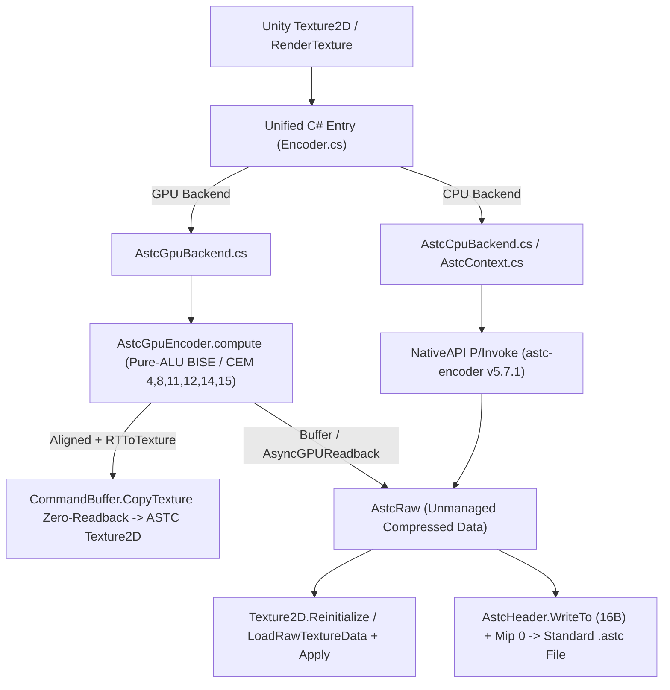

# Runtime ASTC Encoder for Unity

**English** | [简体中文](README_CN.md)

A **runtime ASTC texture compression library** for Unity (Unity Package: `com.aperture.astcenc`), providing both a **native CPU backend** (powered by ARM's official [astc-encoder](https://github.com/ARM-software/astc-encoder) **`v5.7.1`** via P/Invoke) and a **real-time GPU Compute Shader backend**. Through a unified `Encoder` API with switchable `EncodeBackend` (`Cpu` / `Gpu` / `Auto`), it compresses `Texture2D` and `RenderTexture` assets into ASTC textures or standard `.astc` files at runtime on mobile (iOS / Android) and desktop (Windows / macOS Editor & Standalone).

---

## Key Features

- **Unified Dual-Backend Switching (CPU / GPU / Auto)**:
  - **CPU Backend (`EncodeBackend.Cpu`)**: Powered by ARM `astc-encoder v5.7.1`, offering offline-grade compression quality (`Fastest` ~ `Exhaustive`) with no Compute Shader requirement.
  - **GPU Backend (`EncodeBackend.Gpu`)**: Custom cross-platform tableless HLSL Compute Shader encoder (Metal / Vulkan / OpenGL ES 3.1+ / D3D11 / D3D12) supporting **all 6 block sizes (`4x4` ~ `12x12`) and LDR / sRGB / Normal / HDR (`CEM 11/14/15`)**, accepting **`RenderTexture` and non-readable `Texture2D`**, with a **zero-CPU-readback `CommandBuffer.CopyTexture`** fast path for block-aligned dimensions as well as `AsyncGPUReadback` raw-byte export.
  - **Auto Backend (`EncodeBackend.Auto`, default across all APIs)**: Automatically prefers GPU when supported by the device and input texture, seamlessly falling back to CPU otherwise.
- **Flexible Workflows**:
  - In-place compression and GPU upload (`Texture2D.Compress`)
  - One-shot creation of a new compressed texture (`Texture.CompressToTexture`, supporting `RenderTexture` and zero-readback copy)
  - Low-level `CommandBuffer` recording (`Encoder.Encode`, ideal for batching, Async Compute, and dynamic atlas / Virtual Texture sub-region updates)
  - Synchronous / asynchronous raw unmanaged ASTC buffer output (`CompressTexture` / `CompressTextureAsync` → `AstcRaw`)
  - Reusable CPU codec context for batch compression (`AstcContext`)
  - Synchronous / asynchronous standard `.astc` file byte export (`EncodeToASTC` / `EncodeToASTCAsync`, mip 0 only)
- **High Performance & Low GC**:
  - **GPU Backend**: Pure-integer ALU BISE encoding & quantization (zero large constant lookup tables, avoiding Android HLSLcc / mobile GPU register spilling), lossless Void-Extent constant-block fast path, dedicated `CEM 4` + Dual-Plane Normal map encoding, RGBA Dual-Plane and High-tier 2-Partition search, `CommandBuffer`-managed temporary RTs (safe for deferred execution), and `PreloadGpu` / `ReleaseGpuCache` helpers.
  - **CPU Backend**: **Zero-copy direct pointer binding** (`NativeSlice`) for 4-channel `RGBA8` / `RGBA16F` / `RGBA32F` formats (native `MemCpy` snapshot in async mode), zero-allocation conversion for other formats, multi-core parallelism, and `CancellationToken` support.
- **Broad Input Format & Full Mipmap Support**:
  - Supports 24 uncompressed `GraphicsFormat`s (GPU backend also supports 2D `RenderTexture` formats such as `B10G11R11_UFloatPack32`), covering **LDR (8-bit UNorm / sRGB, 16-bit UNorm)** and **HDR (16-bit / 32-bit Float)**.
  - Full per-level mipmap chain compression (including non-square and non-power-of-two textures).
- **Automatic Texture Type & Channel Handling**:
  - Color textures (`TextureType.Default`): Automatic `BGRA` channel swizzling and sRGB color space handling; optional `useAlphaWeight` alpha-weighted RGB error optimization (off by default to preserve ORM / channel-packed mask maps).
  - Normal maps (`TextureType.Normal`): `GGGR` channel swizzling (CPU enables `MapNormal`; GPU uses dedicated `CEM_LDR_LUM_ALPHA_DIRECT` + Dual-Plane independent weight planes and always outputs linear UNorm ASTC regardless of whether the source view is sRGB).

---

## Supported Platforms & Native Libraries

Prebuilt `astc-encoder v5.7.1` native libraries live under `Assets/ASTC Encoder/Plugins/` (tracked with Git LFS):

| Platform | Architecture / Target | Native Binary | P/Invoke `LibraryName` | Build Notes |
| :--- | :--- | :--- | :--- | :--- |
| **iOS** | ARM64 (static library, iOS 12.0+) | `Plugins/iOS/libastcenc-neon-static.a` | `__Internal` | ARM NEON |
| **Android** | `arm64-v8a` (API 21+) | `Plugins/Android/arm64-v8a/libastcenc-neon-shared.so` | `libastcenc-neon-shared` | ARM NEON / `c++_static` / 16KB page aligned |
| **Android** | `armeabi-v7a` (API 21+) | `Plugins/Android/armeabi-v7a/libastcenc-none-shared.so` | `libastcenc-none-shared` | NONE SIMD / `c++_static` / 16KB page aligned |
| **macOS** | Editor & Standalone Universal (11.0+) | `Plugins/Mac/libastcenc-shared.dylib` | `libastcenc-shared` | Universal (`x86_64` SSE4.1 + `x86_64h` AVX2 + `arm64` NEON) |
| **Windows** | Editor & Standalone x64 | `Plugins/x64/astcenc-sse4.1-shared.dll` | `astcenc-sse4.1-shared.dll` | SSE4.1 / static MSVC runtime (`/MT`) |

> **Notes**:
> - On Android, runtime dispatch automatically selects `arm64-v8a` (NEON) or `armeabi-v7a` (NONE) based on `IntPtr.Size == 8`.
> - Platforms without prebuilt native CPU libraries (e.g., Linux / WebGL) still compile cleanly; the CPU backend accurately reports itself as unavailable, while the GPU backend remains usable wherever Compute Shaders are supported.

---

## Requirements & Installation

- **Unity Version**: `2021.3` or newer (sample project uses `2021.3.6f1c1`)
- **Git LFS & Submodule**:
  - Prebuilt native binaries (`.dll` / `.so` / `.a` / `.dylib`) and sample textures are tracked with **Git LFS**.
  - Upstream `astc-encoder` C++ source is linked as a **Git Submodule** at `ThirdParty/astc-encoder` (only needed if rebuilding native libraries).

```bash
git lfs install
git clone --recurse-submodules https://github.com/Overflowu/Runtime-ASTC-Encoder-For-Unity.git
```

### Integrating into an Existing Project

`Assets/ASTC Encoder/` is a self-contained Unity Package (`com.aperture.astcenc`), with its own `Aperture.Astcenc.Runtime.asmdef` enabling `allowUnsafeCode` without affecting the host project:

- **Option 1 (UPM Local / Git URL)**: In Unity Package Manager, choose *Add package from disk...* pointing to `Assets/ASTC Encoder/package.json`, or add via Git URL:
  ```
  https://github.com/Overflowu/Runtime-ASTC-Encoder-For-Unity.git?path=/Assets/ASTC%20Encoder
  ```
- **Option 2 (Direct Copy)**: Copy the entire `Assets/ASTC Encoder` folder into your project's `Assets/` directory.

---

## Quick Start

> **Prerequisites**: Call `Encoder.IsSupport(texture, backend)` at runtime to verify input compatibility. The **CPU backend** and **in-place `Texture2D.Compress`** require **Read/Write Enabled** (`isReadable == true`) on the `Texture2D`; the **GPU backend**'s `CompressToTexture`, `CompressTexture`, `EncodeToASTC`, and `Encode` also support non-readable `Texture2D` and non-MSAA `RenderTexture`.

### 1. In-Place Texture Compression

```csharp
using Aperture.Astcenc.Runtime;
using UnityEngine;

public void CompressInPlace(Texture2D texture)
{
    if (!Encoder.IsSupport(texture))
    {
        Debug.LogError("Texture is not readable or format is unsupported.");
        return;
    }

    // Defaults to EncodeBackend.Auto (prefers GPU, falls back to CPU)
    // threadCount applies to CPU backend only: 1 = single-threaded, <= 0 = auto (up to 4 threads)
    bool ok = texture.Compress(
        textureType: TextureType.Default,
        blockSize: BlockSize.ASTC_6x6,
        quality: CompressQuality.Fast,
        makeNoLongerReadable: true,
        threadCount: 1
    );
}
```

### 2. Async / Multi-Threaded Compression (Recommended for Mobile)

Uses `AsyncGPUReadback` on GPU or captures a pixel snapshot on the main thread and compresses on background worker threads on CPU, avoiding frame drops:

```csharp
using System.Threading.Tasks;
using Aperture.Astcenc.Runtime;
using UnityEngine;

public async Task<Texture2D> CompressAsync(Texture2D inputTexture)
{
    using AstcRaw raw = await inputTexture.CompressTextureAsync(
        textureType: TextureType.Default,
        blockSize: BlockSize.ASTC_6x6,
        quality: CompressQuality.Fast,
        threadCount: 0 // CPU backend: <= 0 auto-selects worker threads
    );

    if (raw == null)
        return null;

    Texture2D outputTexture = new Texture2D(
        inputTexture.width,
        inputTexture.height,
        TextureFormat.ASTC_6x6,
        inputTexture.mipmapCount > 1,
        false);

    outputTexture.name = inputTexture.name;
    outputTexture.LoadRawTextureData(raw);
    outputTexture.Apply(false, true);
    return outputTexture;
}
```

### 3. Batch Compression with a Reusable `AstcContext` (CPU Backend)

When compressing multiple textures with the same format and settings, reusing `AstcContext` avoids repeated `astcenc_context_alloc` overhead:

```csharp
using System.Collections.Generic;
using Aperture.Astcenc.Runtime;
using UnityEngine;
using UnityEngine.Experimental.Rendering;

public void CompressBatch(IList<Texture2D> textures)
{
    using AstcContext context = AstcContext.Create(
        GraphicsFormat.R8G8B8A8_SRGB,
        TextureType.Default,
        BlockSize.ASTC_6x6,
        CompressQuality.Fast,
        threadCount: 0);

    if (context == null)
        return;

    foreach (Texture2D tex in textures)
    {
        using AstcRaw raw = context.CompressTexture(tex, TextureType.Default);
        if (raw != null && tex.Reinitialize(tex.width, tex.height, GraphicsFormat.RGBA_ASTC6X6_SRGB, tex.mipmapCount > 1))
        {
            tex.LoadRawTextureData(raw);
            tex.Apply(false, true);
        }
    }
}
```

### 4. Encode and Save as a Standard `.astc` File

```csharp
using System.IO;
using Aperture.Astcenc.Runtime;
using UnityEngine;

public void SaveAsAstcFile(Texture2D inputTexture, string outputPath)
{
    // Encodes mip 0 only and prepends the standard 16-byte .astc file header
    byte[] fileData = inputTexture.EncodeToASTC(
        TextureType.Default,
        BlockSize.ASTC_6x6,
        CompressQuality.Medium);

    if (fileData != null)
    {
        File.WriteAllBytes(outputPath, fileData);
    }
}
```

### 5. Real-Time GPU Compression (Zero-Readback / `RenderTexture` & Non-Readable `Texture2D`)

```csharp
using Aperture.Astcenc.Runtime;
using UnityEngine;
using UnityEngine.Rendering;

public Texture2D CompressOnGpu(Texture source) // Supports non-readable Texture2D & RenderTexture
{
    // 1. One-shot compressed Texture2D (zero-readback CopyTexture when aligned, GPU Buffer fallback otherwise)
    return source.CompressToTexture(
        textureType: TextureType.Default,
        blockSize: BlockSize.ASTC_6x6,
        quality: CompressQuality.Fast,
        includeMipmaps: true,
        backend: EncodeBackend.Gpu);
}

public void EncodeIntoAtlas(CommandBuffer cmd, Texture tileSrc, Texture2D astcAtlas, int tileX, int tileY)
{
    // 2. CommandBuffer recording (batching / Async Compute / Virtual Texture sub-region updates)
    Encoder.Encode(cmd, tileSrc, astcAtlas, TextureType.Default, BlockSize.ASTC_4x4, CompressQuality.Fast,
        sourceMip: 0, destMip: 0, destX: tileX, destY: tileY);
}
```

A sample scene `Assets/Scenes/SampleScene.unity` and script `Assets/Scripts/Sample.cs` are included so you can switch `EncodeBackend` (`Cpu` / `Gpu` / `Auto`) directly in the Inspector.

---

## API Reference

All public APIs reside in the `Aperture.Astcenc.Runtime` namespace.

### `Encoder` (Unified Entry Point with `EncodeBackend` Switching)

| Method / Property | Description |
| :--- | :--- |
| `Encoder.IsGpuSupported` | Checks whether the current device supports Compute Shaders and `R32G32B32A32_UInt` UAV writes |
| `Encoder.SupportsGpuDirectCopy(blockSize, srgb, isHdr)` | Checks whether the GPU supports zero-readback `CopyTexture` into the target ASTC format |
| `Encoder.PreloadGpu(blockSize)` / `Encoder.ReleaseGpuCache()` | Warms up the GPU Compute Shader (avoids first-frame compilation hitch) / releases cached Compute Shader references (temporary RTs are pooled per call with no persistent VRAM) |
| `Encoder.IsSupport(Texture texture, EncodeBackend backend = EncodeBackend.Auto)` | Checks whether the texture is supported by the given backend (default `Auto`; GPU requires no `isReadable` and supports non-MSAA `RenderTexture`) |
| `Texture.CompressToTexture(..., backend = EncodeBackend.Auto)` | Compresses any 2D `Texture` / `RenderTexture` into a newly allocated ASTC `Texture2D` (prefers zero-readback copy on GPU) |
| `Encoder.Encode(CommandBuffer cmd, source, destination, ...)` | Records GPU ASTC encoding and `CopyTexture` into a `CommandBuffer` (`destX`/`destY` are block-aligned destination texel coordinates; supports sub-regions and custom mips) |
| `Texture2D.Compress(..., backend = EncodeBackend.Auto)` | Compresses a `Texture2D` in-place (default `Auto`; requires `isReadable == true` and a full mipmap chain due to `Reinitialize`; uses zero-readback fast path when aligned and `makeNoLongerReadable == true`; use `CompressToTexture` for non-readable textures) |
| `Texture2D.CompressTexture(..., backend = EncodeBackend.Auto)` / `RenderTexture.CompressTexture(...)` | Synchronously compresses all mipmaps into unmanaged memory and returns `AstcRaw` (must call `Dispose()`) |
| `Texture2D.CompressTextureAsync(..., backend = EncodeBackend.Auto)` / `RenderTexture.CompressTextureAsync(...)` | Asynchronously compresses via GPU `AsyncGPUReadback` or CPU worker threads (default `Auto`), with `CancellationToken` support |
| `Texture2D.LoadRawTextureData(AstcRaw raw)` | Loads compressed bytes from `AstcRaw` directly into a target `Texture2D` |
| `Texture2D.EncodeToASTC(..., backend = EncodeBackend.Auto)` / `Texture.EncodeToASTCAsync(..., backend = EncodeBackend.Auto)` | Encodes mip 0 only with the 16-byte `.astc` file header and returns a managed `byte[]` (works on GPU even on desktop GPUs without hardware ASTC sampling) |

### `AstcContext` (Reusable Native CPU Codec Context)

| Member | Description |
| :--- | :--- |
| `AstcContext.Create(graphicsFormat, textureType, blockSize, quality, threadCount, useAlphaWeight)` | Creates a reusable context (`threadCount <= 0` auto-selects worker threads; sets `a_scale_radius = 1` when `useAlphaWeight` is enabled) |
| `context.CompressTexture(texture, textureType)` | Synchronously compresses a texture reusing this context |
| `context.CompressTextureAsync(texture, textureType, cancellationToken)` | Asynchronously compresses a texture reusing this context (keep the context alive until the returned task completes) |
| `context.Dispose()` | Frees the underlying native `astcenc_context` |

### `AstcRaw` (Unmanaged Compressed Buffer Wrapper)

- `Length`: Total compressed byte length
- `IsDisposed`: Whether the buffer has been disposed
- `CopyTo(byte[] destination, int destinationOffset = 0)` / `ToArray()`: Safely copies compressed bytes into a managed array
- `Dispose()`: Thread-safely frees the underlying unmanaged memory

### Enums & Configuration

- **`EncodeBackend`**: `Cpu` (native `astc-encoder`), `Gpu` (Compute Shader real-time encoder), `Auto` (prefers GPU, falls back to CPU)
- **`TextureType`**: `Default` (color texture), `Normal` (normal map)
- **`BlockSize`** (all 6 supported on both CPU and GPU, 16 bytes per block):
  - `ASTC_4x4` (8.00 bpp) / `ASTC_5x5` (5.12 bpp) / `ASTC_6x6` (3.56 bpp) / `ASTC_8x8` (2.00 bpp) / `ASTC_10x10` (1.28 bpp) / `ASTC_12x12` (0.89 bpp)
- **`CompressQuality`**:
  - CPU backend maps to `astcenc` effort levels: `Fastest` (`0`) / `Fast` (`10`) / `Medium` (`60`) / `Thorough` (`98`) / `VeryThorough` (`99`) / `Exhaustive` (`100`)
  - GPU backend maps to 3 tiers: `Fastest`/`Fast` → single optimal block mode; `Medium` → least-squares endpoint refinement + multi-BlockMode selection + RGBA Dual-Plane; `Thorough`~`Exhaustive` → adds 16-seed directional 2-Partition search
- **`CodecFlags`**: Maps to `astcenc 5.7.1` flags (`MapNormal`, `UseDecodeUnorm8`, `UseAlphaWeight`, `UsePerceptual`, `DecompressOnly`, `SelfDecompressOnly`, `MapRGBM`)

### Supported Input Formats & Target ASTC Mapping

| Input `GraphicsFormat` Category | Supported Formats | `astcenc` Profile | Internal Transfer | Target ASTC `GraphicsFormat` |
| :--- | :--- | :--- | :--- | :--- |
| **LDR 8-bit sRGB** | `R8` / `R8G8` / `R8G8B8` / `R8G8B8A8` / `B8G8R8` / `B8G8R8A8` (`_SRGB`) | `ASTCENC_PRF_LDR_SRGB` (`LDR` for Normal) | `U8` (4-ch zero-copy) | `RGBA_ASTC{N}X{N}_SRGB` (`_UNorm` for Normal) |
| **LDR 8-bit Linear** | `R8` / `R8G8` / `R8G8B8` / `R8G8B8A8` / `B8G8R8` / `B8G8R8A8` (`_UNorm`) | `ASTCENC_PRF_LDR` | `U8` (4-ch zero-copy) | `RGBA_ASTC{N}X{N}_UNorm` |
| **LDR 16-bit Linear** | `R16` / `R16G16` / `R16G16B16` / `R16G16B16A16` (`_UNorm`) | `ASTCENC_PRF_LDR` | `F32` (preserves full 16-bit precision) | `RGBA_ASTC{N}X{N}_UNorm` |
| **HDR 16-bit Float** | `R16` / `R16G16` / `R16G16B16` / `R16G16B16A16` (`_SFloat`) | `ASTCENC_PRF_HDR` | `F16` (4-ch zero-copy) | `RGBA_ASTC{N}X{N}_UFloat` |
| **HDR 32-bit Float** | `R32` / `R32G32` / `R32G32B32` / `R32G32B32A32` (`_SFloat`) | `ASTCENC_PRF_HDR` | `F32` (4-ch zero-copy) | `RGBA_ASTC{N}X{N}_UFloat` |

---

## Architecture



### Implementation Highlights

1. **Context Management (`AstcContext`)**: Creates a native context via `astcenc_config_init` + `astcenc_context_alloc(..., parent_context: IntPtr.Zero)` with `SelfDecompressOnly`; supports multi-core parallel compression (`Parallel.For` assigning unique `thread_index`, falling back to single-threaded for small mip levels to avoid scheduling overhead), `CancellationToken` cancellation (`astcenc_compress_cancel`), and guaranteed `astcenc_compress_reset` in `finally`.
2. **Pre-Allocated Output Buffer**: Sums `ceil(max(1, w >> i) / blockX) * ceil(max(1, h >> i) / blockY) * 16` bytes across all mip levels and allocates a single contiguous unmanaged buffer up front.
3. **Pixel Transfer Optimizations**:
   - `RGBA8` / `RGBA16F` / `RGBA32F` (including `BGRA8`, handled by native `swizzle`) already match `astcenc_image` layout: synchronous mode passes the `NativeSlice` read-only pointer directly (zero-copy); async mode uses bulk `UnsafeUtility.MemCpy`.
   - 1/2/3-channel and 16-bit UNorm formats expand into 4-channel buffers via `IRawData` pointer loops with zero heap allocations (missing RGB filled with `0`, missing Alpha with `1.0` / `0xFF`; 16-bit UNorm outputs `F32` to preserve full precision).
4. **`.astc` Export**: `EncodeToASTC` encodes mip 0 only and writes the 16-byte little-endian header directly via `AstcHeader.WriteTo` (magic `0x5CA1AB13` + 3-byte block dimensions + 3 × 3-byte 24-bit image dimensions), avoiding extra unmanaged allocations.

---

## Automated Cross-Platform Native Builds (GitHub Actions)

The repository includes [.github/workflows/build-native-plugins.yml](.github/workflows/build-native-plugins.yml), which builds all 5 platform binaries from the `ThirdParty/astc-encoder` submodule (automatically stripping Android `.so` symbols and enabling 16KB page alignment) and verifies exported symbols:

- **Automatic**: Triggered on pushes updating `ThirdParty/astc-encoder` or the workflow file, producing the `astcenc-unity-plugins-<version>` artifact.
- **Manual with Auto-Commit**: Trigger `Build Native ASTC Encoder Plugins` manually and check `commit_binaries` to commit the rebuilt binaries directly into `Assets/ASTC Encoder/Plugins/` via Git LFS.

> When upgrading the upstream `astc-encoder` submodule, verify struct fields and function signatures in `Aperture.Astcenc.Runtime.NativeAPI` against `ThirdParty/astc-encoder/Source/astcenc.h`.

---

## Directory Structure

```text
.
├── .github/workflows/
│   └── build-native-plugins.yml           # Cross-platform native library CI build workflow
├── .gitmodules                            # astc-encoder submodule configuration
├── ThirdParty/
│   └── astc-encoder/                      # ARM-software/astc-encoder v5.7.1 source submodule
├── Assets/
│   ├── ASTC Encoder/                      # Unity Package (com.aperture.astcenc v2.0.0)
│   │   ├── package.json
│   │   ├── LICENSE.md                     # MIT License
│   │   ├── Third Party Notices.md         # ARM astc-encoder Apache-2.0 License
│   │   ├── Plugins/                       # Prebuilt v5.7.1 native libraries (Git LFS)
│   │   │   ├── Android/arm64-v8a/libastcenc-neon-shared.so
│   │   │   ├── Android/armeabi-v7a/libastcenc-none-shared.so
│   │   │   ├── iOS/libastcenc-neon-static.a
│   │   │   ├── Mac/libastcenc-shared.dylib
│   │   │   └── x64/astcenc-sse4.1-shared.dll
│   │   └── Runtime/
│   │       ├── Aperture.Astcenc.Runtime.asmdef
│   │       ├── AstcContext.cs             # Reusable CPU codec context (MT / async / cancellation)
│   │       ├── Encoder.cs                 # Unified compression API (Cpu / Gpu / Auto backends)
│   │       ├── EncodeBackend.cs           # Backend enum (Cpu / Gpu / Auto)
│   │       ├── AstcRaw.cs                 # Unmanaged ASTC data wrapper (IDisposable)
│   │       ├── AstcHeader.cs              # 16-byte standard .astc header writer
│   │       ├── ImageExtensions.cs         # Zero-copy / MemCpy / pixel expansion helpers
│   │       ├── RawTextureData.cs          # Zero-GC pixel format writers (16 structs)
│   │       ├── BlockSize.cs               # ASTC block size enum (4x4 ~ 12x12)
│   │       ├── CompressQuality.cs         # Compression quality preset enum
│   │       ├── TextureType.cs             # Texture type enum (Default / Normal)
│   │       ├── CodecFlags.cs              # astcenc codec flag enum
│   │       ├── Cpu/                       # Native CPU backend (astc-encoder P/Invoke)
│   │       │   └── AstcCpuBackend.cs      # Sync/async compression, snapshots, texture helpers
│   │       ├── Gpu/                       # GPU Compute Shader backend
│   │       │   ├── AstcGpuBackend.cs      # GPU dispatch, temp RTs, CopyTexture & AsyncGPUReadback
│   │       │   └── Shaders/
│   │       │       ├── AstcGpuBise.hlsl   # Tableless pure-ALU BISE, quantization & 128-bit packer
│   │       │       ├── AstcGpuColor.hlsl  # sRGB, HDR LNS/FP16, 2-Partition hash & bilinear infill
│   │       │       └── AstcGpuCore.hlsl   # 4x4~12x12, LDR/Normal/HDR & Fast/Balanced/High cores
│   │       ├── Resources/
│   │       │   └── AstcGpuEncoder.compute # Unity ComputeShader (6 block sizes x 2 outputs)
│   │       └── NativeAPI/                 # Aperture.Astcenc.Runtime.NativeAPI (v5.7.1 P/Invoke)
│   │           ├── astcenc_api.cs
│   │           ├── astcenc_config.cs
│   │           ├── astcenc_error.cs
│   │           ├── astcenc_image.cs
│   │           ├── astcenc_profile.cs
│   │           ├── astcenc_swizzle.cs
│   │           ├── astcenc_swz.cs
│   │           └── astcenc_type.cs
│   ├── Resources/                         # Sample textures (Color.png, Normal.png)
│   ├── Scenes/SampleScene.unity           # Sample scene
│   └── Scripts/Sample.cs                  # Sample script (switch Cpu / Gpu / Auto in Inspector)
├── Packages/
├── ProjectSettings/
├── README.md                              # English README
└── README_CN.md                           # Simplified Chinese README
```

---

## Notes & Best Practices

- **Unmanaged Memory Management**: Always dispose `AstcRaw` returned by `CompressTexture` / `CompressTextureAsync` and manually created `AstcContext` instances via `using` or `Dispose()`.
- **GPU Backend Platform Behavior**:
  - On GPUs with native ASTC sampling (iOS / macOS Apple Silicon Metal, Android Vulkan / GLES 3.1+), `CompressToTexture`, `Compress`, and `Encoder.Encode` produce compressed `Texture2D` directly (zero-readback `CopyTexture` for block-aligned dimensions; safe GPU Buffer upload for non-aligned dimensions or full mip tails).
  - On desktop GPUs without hardware ASTC sampling (e.g., Windows D3D11/D3D12), the GPU backend can still export raw ASTC bytes or `.astc` files via `CompressTexture` / `CompressTextureAsync` / `EncodeToASTC` / `EncodeToASTCAsync`. In the Unity Editor, `Compress` / `CompressToTexture` automatically fall back to GPU Buffer + `LoadRawTextureData` for Editor software preview (on standalone builds without ASTC sampling support, creating an ASTC `Texture2D` fails early with a clear error).
  - Call `Encoder.PreloadGpu(...)` at startup or scene transitions to warm up the Compute Shader, and `Encoder.ReleaseGpuCache()` to drop cached shader references when idle. `Encoder.Encode(CommandBuffer, ...)` allocates its intermediate block RT via `CommandBuffer.GetTemporaryRT`, making recorded command buffers safe for deferred or repeated execution.
- **Mobile Performance Tips**: For dynamic or frequently updated textures, prefer `EncodeBackend.Gpu` with `CompressQuality.Fast`. For large textures on CPU, use `CompressTextureAsync` with `Fastest` / `Fast` and reuse `AstcContext`.
- **Async Context Lifetime**: When using `context.CompressTextureAsync(...)`, keep the `AstcContext` alive until the returned `Task<AstcRaw>` completes.
- **Alpha Weighting**: Pass `useAlphaWeight: true` for transparent UI / Sprite / foliage textures; keep the default `useAlphaWeight: false` for channel-packed maps (ORM, masks, etc.).
- **Vertical Coordinate Convention**: Both GPU and CPU backends encode directly in Unity `Texture2D` / `.astc` orientation (row 0 = bottom of texture, `y = 0` with no extra flip). `RenderTexture`s rendered by Unity cameras or `Graphics.Blit` already match this layout; if a `RenderTexture` is written by a custom Compute Shader using top-down coordinates, flip Y before encoding.

---

## License

- This project is licensed under the **MIT License** — see [Assets/ASTC Encoder/LICENSE.md](Assets/ASTC%20Encoder/LICENSE.md).
- The underlying [ARM-software/astc-encoder](https://github.com/ARM-software/astc-encoder) library is licensed under the **Apache License 2.0** — see [Assets/ASTC Encoder/Third Party Notices.md](Assets/ASTC%20Encoder/Third%20Party%20Notices.md).