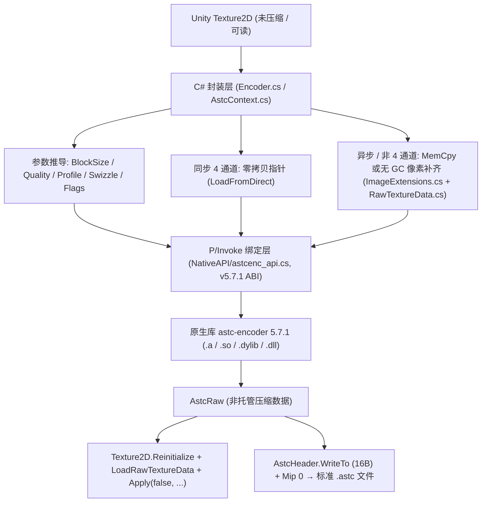

# Runtime ASTC Encoder for Unity

一个面向 Unity 的**运行时 ASTC 纹理压缩库**（Unity Package: `com.aperture.astcenc`），同时提供 **CPU 原生后端**（基于 ARM 官方 [astc-encoder](https://github.com/ARM-software/astc-encoder) **`v5.7.1`** P/Invoke）与 **GPU Compute Shader 实时后端**，支持通过统一的 `Encoder` API 自由切换 `EncodeBackend`（`Cpu` / `Gpu` / `Auto`），在移动端（iOS / Android）及桌面端（Windows / macOS Editor & Standalone）运行时将 `Texture2D` 或 `RenderTexture` 实时压缩为 ASTC 格式或导出为标准 `.astc` 文件。

---

## 核心特性

- **双后端统一切换（CPU / GPU / Auto）**：
  - **CPU 后端（`EncodeBackend.Cpu`）**：基于 ARM `astc-encoder v5.7.1`，提供最高离线级压缩质量（`Fastest` ~ `Exhaustive`），无需 GPU Compute Shader 支持。
  - **GPU 后端（`EncodeBackend.Gpu`）**：自研跨平台无大表 HLSL Compute Shader 编码器（Metal / Vulkan / OpenGL ES 3.1+ / D3D11 / D3D12），**支持全部 6 种 BlockSize（`4x4` ~ `12x12`）及 LDR / sRGB / Normal / HDR（`CEM 11/14/15`）**，支持 **`RenderTexture` 与非可读 `Texture2D`**，对齐尺寸下可走 `CommandBuffer.CopyTexture` **纯 GPU 零 CPU 回读**路径，亦支持 `AsyncGPUReadback` 异步导出原始字节。
  - **自动后端（`EncodeBackend.Auto`）**：设备与输入满足条件时自动优先走 GPU，否则平滑回退到 CPU。
- **多种使用形态**：
  - 原地压缩并上传 GPU（`Texture2D.Compress`）
  - 一站式生成新压缩纹理（`Texture.CompressToTexture`，支持 `RenderTexture` 与零回读拷贝）
  - 底层 `CommandBuffer` 录制（`Encoder.Encode`，支持批处理、Async Compute 与动态图集/Virtual Texture 子区域更新）
  - 同步 / 异步获取非托管原始 ASTC 数据缓冲（`CompressTexture` / `CompressTextureAsync` → `AstcRaw`）
  - 复用 CPU 编码上下文批量压缩（`AstcContext`）
  - 同步 / 异步导出符合标准容器规范的 `.astc` 字节数组（`EncodeToASTC` / `EncodeToASTCAsync`，仅编码 Mip 0）
- **高性能低 GC 设计**：
  - **GPU 后端**：纯整数 ALU BISE 编码与量化（零大常量查找表，规避 Android HLSLcc / 移动 GPU 寄存器溢出）、Void-Extent 纯色块零损快速路径、Normal 贴图专用 `CEM 4` + Dual-Plane、RGBA Dual-Plane 与 High 档位 2-Partition 搜索、内置临时 RT 缓存池与 `PreloadGpu` / `ReleaseGpuCache` 接口。
  - **CPU 后端**：对 `RGBA8` / `RGBA16F` / `RGBA32F` 四通道格式走**零拷贝直传**（`NativeSlice` 指针直接传递，异步模式下采用原生 `MemCpy` 快照），其余格式无堆分配转换，支持多核并行与 `CancellationToken` 取消。
- **丰富的输入格式与完整 Mipmap 支持**：
  - 支持 24 种未压缩 `GraphicsFormat`（GPU 后端亦支持 `B10G11R11_UFloatPack32` 等 2D `RenderTexture`），涵盖 **LDR（8-bit UNorm / sRGB、16-bit UNorm）** 与 **HDR（16-bit / 32-bit Float）**。
  - 支持完整 Mipmap 链逐级压缩（兼容非正方形与非 2 的幂次纹理）。
- **贴图类型与通道自动适配**：
  - 普通贴图（`TextureType.Default`）：自动处理 `BGRA` 通道重排与 sRGB 色彩空间；支持按需开启 `useAlphaWeight` 透明通道加权（默认关闭以避免破坏 ORM / Mask 等通道打包贴图）。
  - 法线贴图（`TextureType.Normal`）：按 `GGGR` 通道重排（CPU 自动启用 `MapNormal`，GPU 专用 `CEM_LDR_LUM_ALPHA_DIRECT` + Dual-Plane 独立权重平面编码）。

---

## 支持平台与原生库

预编译的 `astc-encoder v5.7.1` 原生库位于 `Assets/ASTC Encoder/Plugins/` 目录（由 Git LFS 管理）：

| 平台 | 架构 / 环境 | 原生库文件 | P/Invoke `LibraryName` | 编译特性 |
| :--- | :--- | :--- | :--- | :--- |
| **iOS** | ARM64（静态库，iOS 12.0+） | `Plugins/iOS/libastcenc-neon-static.a` | `__Internal` | ARM NEON |
| **Android** | `arm64-v8a`（API 21+） | `Plugins/Android/arm64-v8a/libastcenc-neon-shared.so` | `libastcenc-neon-shared` | ARM NEON / `c++_static` / 16KB 页对齐 |
| **Android** | `armeabi-v7a`（API 21+） | `Plugins/Android/armeabi-v7a/libastcenc-none-shared.so` | `libastcenc-none-shared` | NONE SIMD / `c++_static` / 16KB 页对齐 |
| **macOS** | Editor & Standalone Universal（11.0+） | `Plugins/Mac/libastcenc-shared.dylib` | `libastcenc-shared` | Universal（`x86_64` SSE4.1 + `x86_64h` AVX2 + `arm64` NEON） |
| **Windows** | Editor & Standalone x64 | `Plugins/x64/astcenc-sse4.1-shared.dll` | `astcenc-sse4.1-shared.dll` | SSE4.1 / 静态 MSVC 运行时（`/MT`） |

> **说明**：
> - Android 运行时会根据 `IntPtr.Size == 8` 自动在 `arm64-v8a`（NEON）与 `armeabi-v7a`（NONE）库之间分派。
> - 未提供原生库的平台（如 Linux / WebGL）可正常通过编译，调用时安全返回 `ASTCENC_ERR_NOT_IMPLEMENTED`。

---

## 环境要求与安装

- **Unity 版本**：`2021.3` 及以上（示例工程版本：`2021.3.6f1c1`）
- **Git LFS 与 Submodule**：
  - 预编译原生库（`.dll` / `.so` / `.a` / `.dylib`）与示例贴图由 **Git LFS** 管理；
  - `astc-encoder` 上游 C++ 源码通过 **Git Submodule** 关联在 `ThirdParty/astc-encoder`（仅在需要自行重新编译原生库时需拉取）。

```bash
git lfs install
git clone --recurse-submodules https://github.com/Overflowu/Runtime-ASTC-Encoder-For-Unity.git
```

### 集成到现有项目

`Assets/ASTC Encoder/` 目录本身是一个标准的 Unity Package（`com.aperture.astcenc`，包内 `Aperture.Astcenc.Runtime.asmdef` 独立启用了 `allowUnsafeCode`，不影响宿主工程配置）：

- **方式一（UPM 本地 / Git 引入）**：在 Unity Package Manager 中选择 *Add package from disk...* 并指向 `Assets/ASTC Encoder/package.json`，或通过 Git URL 引入子目录：
  ```
  https://github.com/Overflowu/Runtime-ASTC-Encoder-For-Unity.git?path=/Assets/ASTC%20Encoder
  ```
- **方式二（直接拷贝）**：将 `Assets/ASTC Encoder` 整个目录复制到目标项目的 `Assets/` 下即可。

---

## 快速开始

> **前置条件**：待压缩的输入 `Texture2D` 必须开启 **Read/Write Enabled**，且格式为受支持的**未压缩** `GraphicsFormat`（可通过 `Encoder.IsSupport(texture)` 在运行时检查）。

### 1. 原地压缩纹理

```csharp
using Aperture.Astcenc.Runtime;
using UnityEngine;

public void CompressInPlace(Texture2D texture)
{
    if (!Encoder.IsSupport(texture))
    {
        Debug.LogError("Texture is not readable or format is unsupported.");
        return;
    }

    // threadCount = 1 为单线程；<= 0 自动按 CPU 核心数选择（最多 4 线程）
    bool ok = texture.Compress(
        textureType: TextureType.Default,
        blockSize: BlockSize.ASTC_6x6,
        quality: CompressQuality.Fast,
        makeNoLongerReadable: true,
        threadCount: 1
    );
}
```

### 2. 后台异步 + 多线程压缩（推荐移动端使用）

在主线程自动抓取像素快照并在后台多线程执行压缩，完成后回到主线程上传 GPU，避免掉帧：

```csharp
using System.Threading.Tasks;
using Aperture.Astcenc.Runtime;
using UnityEngine;

public async Task<Texture2D> CompressAsync(Texture2D inputTexture)
{
    using AstcRaw raw = await inputTexture.CompressTextureAsync(
        textureType: TextureType.Default,
        blockSize: BlockSize.ASTC_6x6,
        quality: CompressQuality.Fast,
        threadCount: 0 // <= 0 自动选择多线程
    );

    if (raw == null)
        return null;

    Texture2D outputTexture = new Texture2D(
        inputTexture.width,
        inputTexture.height,
        TextureFormat.ASTC_6x6,
        inputTexture.mipmapCount > 1,
        false);

    outputTexture.name = inputTexture.name;
    outputTexture.LoadRawTextureData(raw);
    outputTexture.Apply(false, true);
    return outputTexture;
}
```

### 3. 复用 `AstcContext` 批量压缩同规格纹理

批量压缩格式相同的纹理时，复用 `AstcContext` 可避免重复执行昂贵的 `astcenc_context_alloc`：

```csharp
using System.Collections.Generic;
using Aperture.Astcenc.Runtime;
using UnityEngine;
using UnityEngine.Experimental.Rendering;

public void CompressBatch(IList<Texture2D> textures)
{
    using AstcContext context = AstcContext.Create(
        GraphicsFormat.R8G8B8A8_SRGB,
        TextureType.Default,
        BlockSize.ASTC_6x6,
        CompressQuality.Fast,
        threadCount: 0);

    if (context == null)
        return;

    foreach (Texture2D tex in textures)
    {
        using AstcRaw raw = context.CompressTexture(tex, TextureType.Default);
        if (raw != null && tex.Reinitialize(tex.width, tex.height, GraphicsFormat.RGBA_ASTC6X6_SRGB, tex.mipmapCount > 1))
        {
            tex.LoadRawTextureData(raw);
            tex.Apply(false, true);
        }
    }
}
```

### 4. 编码并保存为标准 `.astc` 文件

```csharp
using System.IO;
using Aperture.Astcenc.Runtime;
using UnityEngine;

public void SaveAsAstcFile(Texture2D inputTexture, string outputPath)
{
    // 严格仅编码 Mip 0 并拼接 16 字节标准 ASTC 文件头
    byte[] fileData = inputTexture.EncodeToASTC(
        TextureType.Default,
        BlockSize.ASTC_6x6,
        CompressQuality.Medium);

    if (fileData != null)
    {
        File.WriteAllBytes(outputPath, fileData);
    }
}
```

### 5. GPU 实时压缩（零回读 / 支持 `RenderTexture` 与非可读 `Texture2D`）

```csharp
using Aperture.Astcenc.Runtime;
using UnityEngine;
using UnityEngine.Rendering;

public Texture2D CompressOnGpu(Texture source) // 支持 Texture2D（无需 Read/Write）与 RenderTexture
{
    // 1. 一站式生成压缩 Texture2D（对齐尺寸自动走零回读 Graphics.CopyTexture，否则走 GPU Buffer 安全回退）
    return source.CompressToTexture(
        textureType: TextureType.Default,
        blockSize: BlockSize.ASTC_6x6,
        quality: CompressQuality.Fast,
        includeMipmaps: true,
        backend: EncodeBackend.Gpu);
}

public void EncodeIntoAtlas(CommandBuffer cmd, Texture tileSrc, Texture2D astcAtlas, int tileX, int tileY)
{
    // 2. 底层 CommandBuffer 录制（支持批处理 / Async Compute / Virtual Texture 子区域编码）
    Encoder.Encode(cmd, tileSrc, astcAtlas, TextureType.Default, BlockSize.ASTC_4x4, CompressQuality.Fast,
        sourceMip: 0, destMip: 0, destX: tileX, destY: tileY);
}
```

仓库附带示例场景 `Assets/Scenes/SampleScene.unity` 与脚本 `Assets/Scripts/Sample.cs`，可在 Inspector 中直接切换 `EncodeBackend`（`Cpu` / `Gpu` / `Auto`）运行体验。

---

## API 参考

所有对外 API 位于命名空间 `Aperture.Astcenc.Runtime` 下。

### `Encoder`（统一压缩入口，支持 `EncodeBackend` 切换）

| 方法 / 属性 | 说明 |
| :--- | :--- |
| `Encoder.IsGpuSupported` | 检测当前设备是否支持 GPU Compute Shader 与 `R32G32B32A32_UInt` 写入 |
| `Encoder.SupportsGpuDirectCopy(blockSize, srgb, isHdr)` | 检测当前 GPU 是否支持零回读 `CopyTexture` 直出目标 ASTC 格式纹理 |
| `Encoder.PreloadGpu(blockSize)` / `Encoder.ReleaseGpuCache()` | 预热 GPU Compute Shader（避免首帧编译卡顿）/ 释放临时 RT 缓存池 |
| `Encoder.IsSupport(Texture texture, EncodeBackend backend = EncodeBackend.Auto)` | 检查纹理是否满足指定后端要求（默认 `Auto`；GPU 后端无需 `isReadable` 且支持 `RenderTexture`） |
| `Texture.CompressToTexture(..., backend = EncodeBackend.Auto)` | 压缩任意 2D `Texture` / `RenderTexture` 并返回新的压缩 `Texture2D`（GPU 优先零回读拷贝） |
| `Encoder.Encode(CommandBuffer cmd, source, destination, ...)` | 向 `CommandBuffer` 录制 GPU ASTC 编码与 `CopyTexture`（支持子区域与自定义 Mip） |
| `Texture2D.Compress(..., backend = EncodeBackend.Auto)` | 原地压缩 `Texture2D`（默认 `Auto`；GPU 后端无需 `isReadable`，对齐尺寸走零回读路径） |
| `Texture2D.CompressTexture(..., backend = EncodeBackend.Auto)` / `RenderTexture.CompressTexture(...)` | 同步压缩全部 Mipmap 至非托管内存，返回 `AstcRaw`（需 `Dispose()`） |
| `Texture2D.CompressTextureAsync(..., backend = EncodeBackend.Auto)` / `RenderTexture.CompressTextureAsync(...)` | 异步压缩（默认 `Auto`；GPU `AsyncGPUReadback` / CPU 后台多线程），均支持 `CancellationToken` |
| `Texture2D.LoadRawTextureData(AstcRaw raw)` | 将 `AstcRaw` 中的压缩数据直接加载到目标 `Texture2D` |
| `Texture2D.EncodeToASTC(..., backend = EncodeBackend.Auto)` / `Texture.EncodeToASTCAsync(..., backend = EncodeBackend.Auto)` | 仅压缩 Mip 0 并写入 16 字节标准 `.astc` 文件头，返回托管 `byte[]`（PC 无 ASTC 采样硬件时亦可走 GPU 高速导出） |

### `AstcContext`（可复用原生 CPU 编码上下文）

| 成员 | 说明 |
| :--- | :--- |
| `AstcContext.Create(graphicsFormat, textureType, blockSize, quality, threadCount, useAlphaWeight)` | 创建可复用上下文（`threadCount <= 0` 自动选择线程数；开启 `useAlphaWeight` 时自动设 `a_scale_radius = 1`） |
| `context.CompressTexture(texture, textureType)` | 复用当前上下文同步压缩纹理 |
| `context.CompressTextureAsync(texture, textureType, cancellationToken)` | 复用当前上下文异步压缩纹理（任务完成前需保持上下文未释放） |
| `context.Dispose()` | 释放底层 `astcenc_context` 原生内存 |

### `AstcRaw`（非托管压缩数据封装）

- `Length`：压缩后总字节数
- `IsDisposed`：是否已释放
- `CopyTo(byte[] destination, int destinationOffset = 0)` / `ToArray()`：安全拷贝原始压缩字节到托管数组
- `Dispose()`：释放底层非托管内存

### 枚举与配置参数

- **`EncodeBackend`**：`Cpu`（原生 `astc-encoder`）、`Gpu`（Compute Shader 实时编码）、`Auto`（优先 GPU，不支持时自动回退 CPU）
- **`TextureType`**：`Default`（普通颜色贴图）、`Normal`（法线贴图）
- **`BlockSize`**（CPU 与 GPU 均完整支持以下 6 种，每块固定 16 字节）：
  - `ASTC_4x4` (8.00 bpp) / `ASTC_5x5` (5.12 bpp) / `ASTC_6x6` (3.56 bpp) / `ASTC_8x8` (2.00 bpp) / `ASTC_10x10` (1.28 bpp) / `ASTC_12x12` (0.89 bpp)
- **`CompressQuality`**：
  - CPU 后端映射到 `astcenc` 质量参数：`Fastest` (`0`) / `Fast` (`10`) / `Medium` (`60`) / `Thorough` (`98`) / `VeryThorough` (`99`) / `Exhaustive` (`100`)
  - GPU 后端映射到 3 档策略：`Fastest`/`Fast` → 单最优模式极速档；`Medium` → 最小二乘端点微调 + 多 BlockMode 择优 + RGBA Dual-Plane；`Thorough`~`Exhaustive` → 叠加 16 方向精选 2-Partition 搜索
- **`CodecFlags`**：映射 `astcenc 5.7.1` 标志位（`MapNormal`、`UseDecodeUnorm8`、`UseAlphaWeight`、`UsePerceptual`、`DecompressOnly`、`SelfDecompressOnly`、`MapRGBM`）

### 支持的输入格式与目标格式映射

| 输入 `GraphicsFormat` 类别 | 支持的具体格式 | `astcenc` 色彩配置 | 内部传输路径 | 目标 ASTC `GraphicsFormat` |
| :--- | :--- | :--- | :--- | :--- |
| **LDR 8-bit sRGB** | `R8` / `R8G8` / `R8G8B8` / `R8G8B8A8` / `B8G8R8` / `B8G8R8A8` (`_SRGB`) | `ASTCENC_PRF_LDR_SRGB` | `U8`（4 通道零拷贝直传） | `RGBA_ASTC{N}X{N}_SRGB` |
| **LDR 8-bit Linear** | `R8` / `R8G8` / `R8G8B8` / `R8G8B8A8` / `B8G8R8` / `B8G8R8A8` (`_UNorm`) | `ASTCENC_PRF_LDR` | `U8`（4 通道零拷贝直传） | `RGBA_ASTC{N}X{N}_UNorm` |
| **LDR 16-bit Linear** | `R16` / `R16G16` / `R16G16B16` / `R16G16B16A16` (`_UNorm`) | `ASTCENC_PRF_LDR` | `F32`（无损保留 16-bit 精度） | `RGBA_ASTC{N}X{N}_UNorm` |
| **HDR 16-bit Float** | `R16` / `R16G16` / `R16G16B16` / `R16G16B16A16` (`_SFloat`) | `ASTCENC_PRF_HDR` | `F16`（4 通道零拷贝直传） | `RGBA_ASTC{N}X{N}_UFloat` |
| **HDR 32-bit Float** | `R32` / `R32G32` / `R32G32B32` / `R32G32B32A32` (`_SFloat`) | `ASTCENC_PRF_HDR` | `F32`（4 通道零拷贝直传） | `RGBA_ASTC{N}X{N}_UFloat` |

---

## 实现原理与架构



### 核心流程说明

1. **上下文管理（`AstcContext`）**：通过 `astcenc_config_init` + `astcenc_context_alloc(..., parent_context: IntPtr.Zero)` 创建支持 `SelfDecompressOnly` 的原生上下文；支持多核并行压缩（`Parallel.For` 分配唯一 `thread_index`，小尺寸 Mipmap 自动退回单线程以避免调度开销）与 `CancellationToken` 取消（安全注册 `astcenc_compress_cancel`），每次压缩后在 `finally` 中调用 `astcenc_compress_reset`。
2. **输出缓冲预分配**：按每级 `ceil(max(1, w >> i) / blockX) * ceil(max(1, h >> i) / blockY) * 16` 字节累加所有 Mipmap 总长度，一次性分配连续非托管内存。
3. **像素传输优化**：
   - `RGBA8` / `RGBA16F` / `RGBA32F`（含 `BGRA8`，通道重排交由原生 `swizzle` 处理）内存布局已与 `astcenc_image` 对齐：同步模式直接传递 `NativeSlice` 只读指针（零拷贝），异步模式用 `UnsafeUtility.MemCpy` 整块快照。
   - 1/2/3 通道与 16-bit UNorm 格式通过 `IRawData` 指针循环与 `Marshal.WriteInt16` / `WriteInt32` 写入 4 通道缓冲，零堆分配（缺失 RGB 补 `0`，缺失 Alpha 补 `1.0` / `0xFF`；16-bit UNorm 直接输出 `F32` 保留全部 16-bit 精度）。
4. **`.astc` 导出**：`EncodeToASTC` 仅压缩 Mip 0，并通过静态方法 `AstcHeader.WriteTo` 直接写入 16 字节小端文件头（魔数 `0x5CA1AB13` + 3 字节块尺寸 + 3 × 3 字节 24-bit 图像尺寸），不产生额外的非托管头分配与 Finalizer 开销。

---

## 跨平台原生库自动构建（GitHub Actions）

仓库内置跨平台自动构建工作流 [.github/workflows/build-native-plugins.yml](.github/workflows/build-native-plugins.yml)，可直接基于 `ThirdParty/astc-encoder` 子模块一次编出全部 5 个平台产物（Android `.so` 自动 Strip 调试符号并启用 16KB 页对齐）并校验导出符号：

- **自动触发**：当更新 `ThirdParty/astc-encoder` 子模块或修改工作流文件并推送时，自动编译并打包为 `astcenc-unity-plugins-<version>` Artifact。
- **手动触发并自动提交**：在 GitHub Actions 页面运行 `Build Native ASTC Encoder Plugins` 并勾选 `commit_binaries`，工作流会自动将编出的 5 个原生库通过 Git LFS 提交回当前分支的 `Assets/ASTC Encoder/Plugins/` 目录。

> 升级上游 `astc-encoder` 子模块版本时，请对照 `ThirdParty/astc-encoder/Source/astcenc.h` 核对 `Aperture.Astcenc.Runtime.NativeAPI` 中的结构体字段与函数签名是否发生 ABI 变更。

---

## 目录结构

```text
.
├── .github/workflows/
│   └── build-native-plugins.yml           # 全平台原生库自动编译与打包工作流
├── .gitmodules                            # astc-encoder 子模块配置
├── ThirdParty/
│   └── astc-encoder/                      # ARM-software/astc-encoder v5.7.1 源码子模块
├── Assets/
│   ├── ASTC Encoder/                      # Unity Package (com.aperture.astcenc v2.0.0)
│   │   ├── package.json
│   │   ├── LICENSE.md                     # MIT License
│   │   ├── Third Party Notices.md         # ARM astc-encoder Apache-2.0 License
│   │   ├── Plugins/                       # 各平台预编译 v5.7.1 原生库 (Git LFS)
│   │   │   ├── Android/arm64-v8a/libastcenc-neon-shared.so
│   │   │   ├── Android/armeabi-v7a/libastcenc-none-shared.so
│   │   │   ├── iOS/libastcenc-neon-static.a
│   │   │   ├── Mac/libastcenc-shared.dylib
│   │   │   └── x64/astcenc-sse4.1-shared.dll
│   │   └── Runtime/
│   │       ├── Aperture.Astcenc.Runtime.asmdef
│   │       ├── AstcContext.cs             # 可复用 CPU 编码上下文（多线程 / 异步 / 取消支持）
│   │       ├── Encoder.cs                 # 统一压缩入口（支持 Cpu / Gpu / Auto 后端切换）
│   │       ├── EncodeBackend.cs           # 编码后端枚举 (Cpu / Gpu / Auto)
│   │       ├── AstcRaw.cs                 # 非托管 ASTC 压缩数据封装 (IDisposable)
│   │       ├── AstcHeader.cs              # 16 字节标准 .astc 文件头工具
│   │       ├── ImageExtensions.cs         # astcenc_image 零拷贝 / MemCpy / 像素转换 (internal)
│   │       ├── RawTextureData.cs          # 16 种像素格式无 GC 写入结构体
│   │       ├── BlockSize.cs               # ASTC 块尺寸枚举 (4x4 ~ 12x12)
│   │       ├── CompressQuality.cs         # 压缩质量预设枚举
│   │       ├── TextureType.cs             # 贴图类型枚举 (Default / Normal)
│   │       ├── CodecFlags.cs              # astcenc 编码标志位枚举
│   │       ├── Cpu/                       # CPU 原生后端实现 (astc-encoder P/Invoke)
│   │       │   └── AstcCpuBackend.cs      # CPU 同步/异步压缩、快照、原地与新纹理封装
│   │       ├── Gpu/                       # GPU Compute Shader 后端实现
│   │       │   ├── AstcGpuBackend.cs      # GPU 调度、RT 池、CopyTexture 与 AsyncGPUReadback
│   │       │   └── Shaders/
│   │       │       ├── AstcGpuBise.hlsl   # 无大表纯 ALU BISE、量化/反量化与 128-bit 组装
│   │       │       ├── AstcGpuColor.hlsl  # sRGB、HDR LNS/FP16、2-Partition 哈希与双线性插值
│   │       │       └── AstcGpuCore.hlsl   # 4x4~12x12、LDR/Normal/HDR 与 Fast/Balanced/High 核
│   │       ├── Resources/
│   │       │   └── AstcGpuEncoder.compute # Unity ComputeShader（6 BlockSize × 2 输出目标）
│   │       └── NativeAPI/                 # Aperture.Astcenc.Runtime.NativeAPI (v5.7.1 P/Invoke)
│   │           ├── astcenc_api.cs
│   │           ├── astcenc_config.cs
│   │           ├── astcenc_error.cs
│   │           ├── astcenc_image.cs
│   │           ├── astcenc_profile.cs
│   │           ├── astcenc_swizzle.cs
│   │           ├── astcenc_swz.cs
│   │           └── astcenc_type.cs
│   ├── Resources/                         # 示例贴图 (Color.png, Normal.png)
│   ├── Scenes/SampleScene.unity           # 示例场景
│   └── Scripts/Sample.cs                  # 示例脚本（支持 Inspector 切换 Cpu / Gpu / Auto）
├── Packages/
├── ProjectSettings/
└── README.md
```

---

## 注意事项

- **非托管内存管理**：直接调用 `CompressTexture` / `CompressTextureAsync` 返回的 `AstcRaw` 持有非托管内存，以及手动创建的 `AstcContext` 均需通过 `using` 或 `Dispose()` 及时释放。
- **GPU 后端平台特性**：
  - 在支持 ASTC 硬件采样的 GPU（iOS/macOS Apple Silicon Metal、Android Vulkan/GLES 3.1+）上，`CompressToTexture` / `Compress` / `Encoder.Encode` 可直接生成压缩 `Texture2D`（尺寸与 BlockSize 对齐时走零回读 `CopyTexture`，非对齐尺寸或完整 Mip 尾级自动走 GPU Buffer 安全上传）。
  - 在不支持 ASTC 硬件采样的桌面 GPU（如 Windows D3D11/D3D12）上，GPU 后端仍可通过 `CompressTexture` / `CompressTextureAsync` / `EncodeToASTC` / `EncodeToASTCAsync` 高速生成原始 ASTC 数据或 `.astc` 文件；在 Unity Editor 中，`Compress` / `CompressToTexture` 也会自动走 GPU Buffer + `LoadRawTextureData` 回退路径并由 Editor 软件预览。
  - 建议在启动或场景切换时调用 `Encoder.PreloadGpu(...)` 预热 Compute Shader，切换场景或不再使用时调用 `Encoder.ReleaseGpuCache()` 释放临时 RT 缓存。
- **移动端性能建议**：高频/动态贴图推荐优先使用 `EncodeBackend.Gpu` 配合 `CompressQuality.Fast`；CPU 后端压缩大图建议使用 `CompressTextureAsync` 配合 `Fastest` / `Fast` 并复用 `AstcContext`。
- **异步压缩上下文生命周期**：使用 `context.CompressTextureAsync(...)` 时，请确保在返回的 `Task<AstcRaw>` 完成前不要释放该 `AstcContext`。
- **透明贴图加权**：对于带透明通道的 UI / Sprite / 植被贴图，建议传入 `useAlphaWeight: true`；对于 ORM / Mask 等通道打包贴图保持默认 `useAlphaWeight: false`。

---

## 许可证

- 本项目代码采用 **MIT License**，详见 [Assets/ASTC Encoder/LICENSE.md](Assets/ASTC%20Encoder/LICENSE.md)。
- 底层编码库 [ARM-software/astc-encoder](https://github.com/ARM-software/astc-encoder) 采用 **Apache License 2.0**，详见 [Assets/ASTC Encoder/Third Party Notices.md](Assets/ASTC%20Encoder/Third%20Party%20Notices.md)。