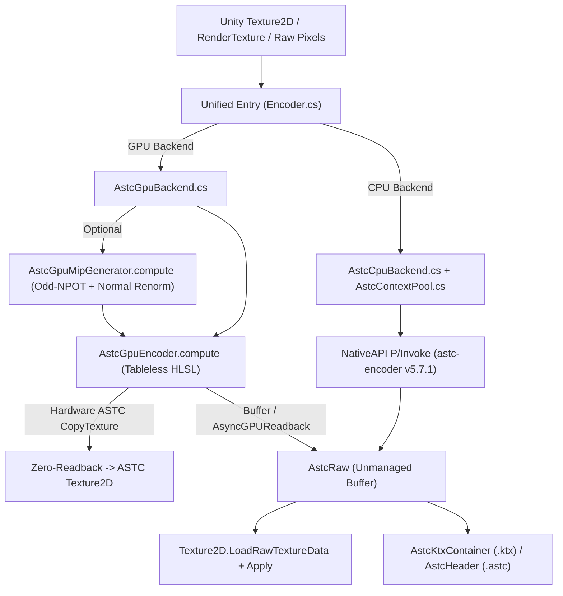

# Architecture & Implementation Details

## High-Level Dataflow

---

## GPU Compute Shader Backend

Located under `Assets/ASTC Encoder/Runtime/Gpu/` and `Runtime/Resources/`:

- **Tableless Pure-ALU Encoding (`AstcGpuBise.hlsl`)**: Performs BISE quantization, unquantization, and 128-bit block packing using integer ALU instructions with no large lookup tables, keeping constant-buffer and L1 cache footprints minimal across mobile tile-based GPUs (Metal / Vulkan / GLES 3.1+) and desktop GPUs (D3D11 / D3D12).
- **Per-Block Kernel Specialization (`AstcGpuEncoder.compute` / `AstcGpuCore.hlsl`)**:
  - Separate `ASTC_FAST_ONLY` kernels (`Fastest` / `Fast`) and Full kernels (`Medium`–`Exhaustive`) to avoid register bloat in real-time modes.
  - Per-block `ASTC_MAX_GRID` sizing (`4x4` → 16, `5x5` → 25, `>=6x6` → 36) to cut VGPR usage.
  - `[numthreads(8, 4, 1)]` occupancy tuning for `>=8x8` blocks.
  - On-chip packed `RGBA8` pixel cache for `<=6x6` LDR blocks.
- **High-Quality Compression Without Redundant Scans (`AstcGpuCore.hlsl` / `AstcGpuColor.hlsl`)**:
  - Lossless Void-Extent fast path for constant blocks.
  - Zero-`pow()` `sqrt` sRGB approximation (`0/256` 8-bit round-trip error).
  - Row-level early-exit candidate pruning.
  - Same-grid continuous weight projection reuse across quantization candidates, combined 1P error + worst-channel accumulation (eliminating worst-channel rescans), merged 3-pass 2-Partition dual-subset endpoint fitting, and loop-hoisted `AstcHash52` (`AstcPreparePartition2`).
  - Isotropic and anisotropic weight grids (`6x4`/`4x6`/`8x4`/`4x8`), dynamic-CCS Dual-Plane for both RGB (ORM/MRAO) and RGBA, post-quantization ideal endpoint refit, dedicated `CEM 4` + tangent-space angular-error Dual-Plane for Normal maps, and HDR `CEM 11/14/15` high-precision delta modes.
- **Zero-Readback Mipmap + CopyTexture Pipeline (`AstcGpuMipGenerator.compute` / `AstcGpuBackend.cs`)**:
  - Generates the full mipmap chain (handling odd-NPOT edge texels and tangent-space normal renormalization) and encodes every mip into ASTC inside a single `CommandBuffer`.
  - Uses `CommandBuffer.CopyTexture` on block coordinates (`ceil(mipW / bx) × ceil(mipH / by)`) for zero-CPU-readback uploads across both aligned and non-multiple dimensions, including full mipmap tails.
  - When CPU access is requested (`CompressTextureAsync` / `EncodeToASTCAsync` / `EncodeToKTXAsync`), uses LOH-free `AsyncGPUReadback`.

---

## Native CPU Backend

Located under `Assets/ASTC Encoder/Runtime/Cpu/` and `Runtime/NativeAPI/`:

- **Runtime ISA Dispatch (`astcenc_api.cs`)**:
  - **Windows x64**: Probes AVX2 via `IsProcessorFeaturePresent(40)` at startup and binds `astcenc-avx2-shared.dll`, falling back seamlessly to `astcenc-sse4.1-shared.dll`.
  - **Android**: Dispatches `libastcenc-neon-shared.so` (`arm64-v8a`) vs `libastcenc-none-shared.so` (`armeabi-v7a`) based on `IntPtr.Size == 8`.
  - **macOS**: Universal dylib (`x86_64` SSE4.1 + `x86_64h` AVX2 + `arm64` NEON).
  - **iOS**: Static NEON library (`__Internal`).
  - **WebGL (WASM)**: Static Emscripten C++ source plugins under `Plugins/WebGL/` (`__Internal`), automatically compiled by Unity's bundled Emscripten toolchain to avoid cross-version ABI mismatches; runtime clamps thread count to `1` and runs async CPU/cache tasks inline with frame-budgeted `AstcCompressionQueue` dispatching.
- **Context Pooling & `parentContext` Sharing (`AstcContextPool.cs` / `AstcContext.cs`)**:
  - Thread-safe static pool eliminates per-call `astcenc_context_alloc` / `free` overhead across all static CPU APIs.
  - Shares read-only block lookup tables via `astcenc 5.x` `parentContext` per `BlockSize`, with safe deferred parent disposal on `Encoder.ReleaseCpuContextPool()` or application quit.
  - Supports multi-core `Parallel.For` or optional Unity Job System (`IJobParallelFor`), `CancellationToken` cancellation (`astcenc_compress_cancel`), and guaranteed `astcenc_compress_reset`.
- **Zero-Copy & Low-Memory Pixel Transfer (`ImageExtensions.cs` / `RawTextureData.cs`)**:
  - 4-channel `RGBA8` / `BGRA8` / `RGBA16F` / `RGBA32F` pass `NativeSlice` read-only pointers directly in synchronous mode (zero copy).
  - Asynchronous mode takes a single compact `UnsafeUtility.MemCpy` snapshot on the main thread and expands/compresses one mip level at a time on background threads (up to 8× lower peak memory for 1/2/3-channel and 16-bit formats).
  - 1/2/3-channel and 16-bit UNorm formats expand via `unsafe` pointer loops with zero managed heap allocations.

---

## Automated Builds, Verification & Releases (GitHub Actions)

The repository includes five CI workflows under `.github/workflows/`:

1. **`verify-shaders-and-code.yml`**: Manually dispatched (`workflow_dispatch`) workflow that validates HLSL/Compute shader syntax across all block sizes and verifies Unity `.meta` file completeness and GUID uniqueness.
2. **`build-native-plugins.yml`**: Builds all native `astc-encoder` binaries from `ThirdParty/astc-encoder` (Windows x64 AVX2 + SSE4.1, macOS Universal, iOS ARM64 + `astcenc.xcframework`, Android `arm64-v8a` / `armeabi-v7a` with symbol stripping and 16 KB page alignment, Linux x64 SSE4.1) and verifies exported symbols. Automatically runs on non-`master` pushes touching the submodule or workflow file, and can be manually dispatched (`commit_binaries: true` commits updated binaries and Linux `.meta` files via Git LFS).
   - When upgrading `ThirdParty/astc-encoder`, verify struct layouts and signatures in `Runtime/NativeAPI/` against `ThirdParty/astc-encoder/Source/astcenc.h`.
3. **`unity-multiplatform-e2e.yml`**: Manually dispatched (`workflow_dispatch`) workflow that runs Unity EditMode tests (`Aperture.Astcenc.Tests`) and builds/executes end-to-end smoke tests across Linux x64, Windows x64, macOS Universal, Android ARM64 (emulator), and iOS ARM64 (Xcode build & link) on demand.
4. **`performance-benchmarks.yml`**: Manually dispatched (`workflow_dispatch`) workflow that runs cross-platform native CPU SIMD benchmarks and Unity Standalone Player GPU/CPU benchmarks, optionally syncing results into `README.md`, `README_CN.md`, `docs/Benchmarks.md`, and `docs/benchmarks/baseline.json`.
5. **`release-package.yml`**: Automatically triggered when a `develop` → `master` pull request is merged (also supports manual `workflow_dispatch`). Verifies resolved LFS native plugins, creates the `v<version>` Git tag from `package.json`, packages both a UPM tarball (`com.aperture.astcenc-<version>.tgz`) and a direct Assets `.zip` archive with SHA-256 checksums, extracts notes from `CHANGELOG.md`, and publishes a GitHub Release.
